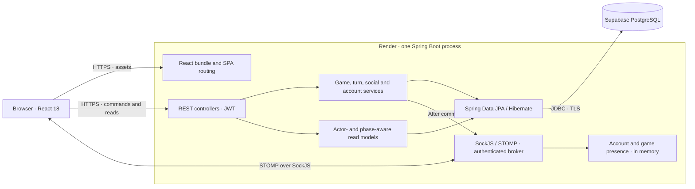
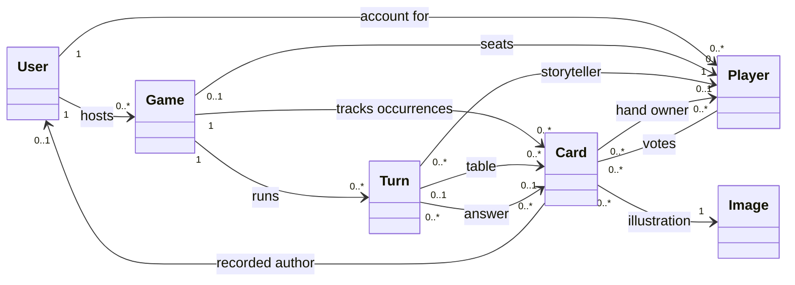
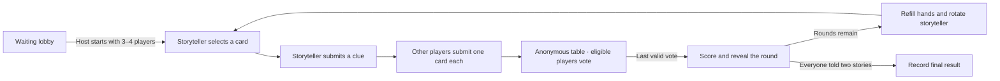
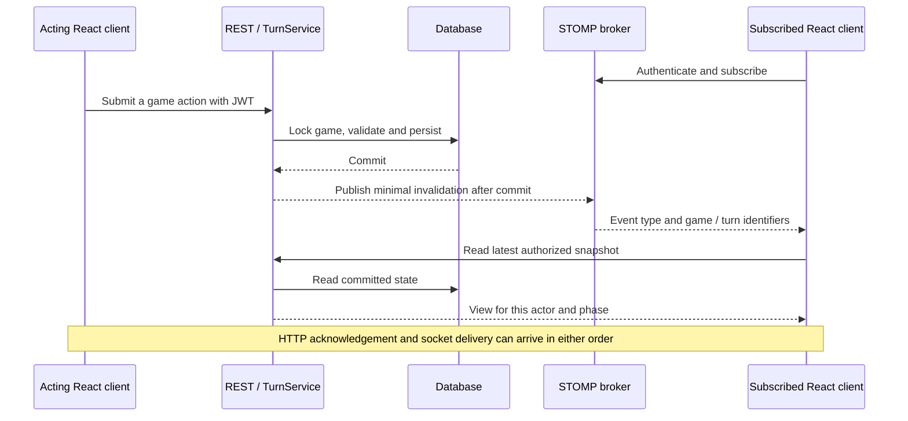

# DIXIT — Online Multiplayer Game

Dixit is an online storytelling game for three or four people. Start a lobby with friends, take turns giving clues about illustrated cards, and try to pick the storyteller’s card from the table. Everyone gets two turns as storyteller.

[Play Dixit](https://dixit-demo-20261110-g.onrender.com) · [API documentation](https://dixit-demo-20261110-g.onrender.com/docs) · [Documentation](docs/README.md)

The demo runs on Render Free. If the server has gone to sleep, the first visit can take a few minutes.

## Features

- Account registration and JWT authentication; host-controlled lobbies and invitations.
- Turn-based multiplayer with live updates, chat and authorized spectator views.
- Private hands and phase-aware responses; stable anonymous card ordering.
- Friends, presence, invitations, achievements, statistics and game history.
- Responsive, keyboard-accessible controls and reduced-motion alternatives.
- Card replenishment that preserves earlier turns, authorship and votes.

## Architecture at a glance

The deployment is a modular monolith. Render runs one Spring Boot process that serves the React bundle, accepts HTTP commands and hosts the STOMP broker. Supabase supplies PostgreSQL. The browser communicates with Spring Boot, and all game rules are enforced on the server. In development, React runs separately with a proxy to Spring Boot, which uses H2.



Controllers define the HTTP boundary. Services coordinate business rules, authorization and transactions. Repositories load and persist entities. This retains the course's controller/service/repository architecture and adds explicit read models and authenticated real-time transport. React handles input, local presentation and animations. Gameplay state remains server-authoritative.

## Domain model



This view focuses on gameplay. `User` is the account used for authentication and statistics. `Player` is a participation, with its own identity, score and hand. An account can have several participations, and a Player record can exist without an assigned game. The active game admits three or four participants at start.

`Image` is a reusable illustration. `Card` represents a specific occurrence of that illustration in a game and carries its own identity, turn, author and votes. When newly available images run out, the game creates new Card occurrences for eligible historical images. Images already in active hands or on the active table are excluded. This lets a four-player game begin each round with six cards per player while retaining the full voting history.

Friend requests relate accounts. A game invitation records a lobby ID and its recipient. Because the lobby can disappear independently, listing checks for a joinable lobby and accepting rechecks under lock. A definitively expired invitation is removed and the requester receives HTTP 410. A full lobby returns 409 and keeps the invitation. Home and the social panel share the invitation state.

## A round from lobby to results



The first storyteller is chosen randomly. The storyteller sits out voting, and the other players each vote once for a card they did not play. If everyone or nobody guesses correctly, the non-storytellers get two points each. Otherwise the storyteller and correct guessers get three each. Non-storytellers also receive a point for each vote their own card attracts. The game ends after six or eight turns, depending on player count. The highest score wins, with ties supported.

The vote handler locks the game before loading and validating the current turn. The last vote drives scoring and either advances and refills the game or finalizes it. These changes share the transaction. The final round skips replenishment. The game lock serializes competing actions, and the service checks the actor, current phase, card ownership and duplicate submissions before applying changes.

## How clients stay in sync



`useGameSocket` handles the connection and `useGameTurnState` coordinates reads for the game UI. The timing of HTTP responses and socket delivery can vary. React rejects superseded reads and fetches fresh state after reconnecting. The backend controls subscription access. Socket messages signal changes, while REST provides the state each client may see.

| Boundary | What it enforces |
| --- | --- |
| REST authentication | Spring Security validates JWT and resolves the authenticated account. |
| Game commands | Membership, role within the game, turn phase, ownership and duplicate action checks govern writes. Only the host starts a ready lobby. |
| Game reads | Projections expose the actor's own hand, public state and phase-appropriate information. Spectator perspectives require eligibility. Votes and the answer are disclosed according to the phase and actor. |
| STOMP | CONNECT authenticates the actor. Subscription and delivery rules check access to the relevant game or turn. Clients cannot publish game state to the broker. |

## Operations and trade-offs

- **Persistence.** Flyway applies versioned migrations against PostgreSQL, and Hibernate validates the schema. Migration and application roles have separate credentials. The production package excludes academic seed data.
- **Presence and reconnection.** Account presence and game presence are tracked separately. Loss of the host's game connection starts a 30-second grace period once detected. A non-host participant can return to the same seat. A host departure or grace-period expiry cancels the game while preserving its recorded history.
- **Process failure.** A PostgreSQL session guard fences competing application runtimes. A restart can cancel interrupted games and preserve recorded results and history. Live connections, timers and the in-memory broker are recreated on startup.
- **Build and delivery.** GitHub Actions tests React and Java, runs PostgreSQL acceptance checks, verifies the executable JAR and Docker image, and exercises backup and restore. Render updates are manual. Planned replacement closes admissions, waits for live games to finish, verifies a backup and stops the running process before starting its replacement.

## Original design diagrams and the current implementation

| Earlier diagram | Current reading |
| --- | --- |
| [Layer diagram](docs/diagrams/layer-diagram.mmd) | The three original backend layers remain. The runtime diagram above adds React delivery, the security boundary, STOMP, the read models and deployment. |
| [Domain diagram](docs/diagrams/domain-diagram.mmd) | The account/participation and illustration/card distinctions remain central. See the updated gameplay view above and ADR-0001 for the historical card lifecycle. |
| [Class diagram](docs/diagrams/class-diagram.mmd) | The detailed class inventory provides design context. See the current transaction and transport views above for how those classes cooperate at runtime. |

Read the [current architecture guide](docs/architecture.md) for the ADR map and the [documentation index](docs/README.md) for requirements, testing and operations.

## Run locally

Use Java 21 and the Node version in `frontend/.nvmrc`. Start from the reviewed development branch:

```sh
git clone --branch develop https://github.com/NicodAlba/Dixit-online.git
cd Dixit-online
./mvnw spring-boot:run
```

In a second terminal, from the repository root:

```sh
cd frontend
npm ci --no-audit --no-fund
npm start
```

Open http://localhost:3000. Development uses disposable H2 data; restarting can reset accounts and games. Do not connect this development setup to the hosted database. See [local setup and verification](docs/local-development.md) for packaging, tests and configuration boundaries.

## Quality and delivery

GitHub Actions runs frontend/backend tests, isolated PostgreSQL acceptance, executable JAR checks, backup/restore and actual Docker-image checks. CI does **not** deploy the demo. Results belong to a specific commit; consult [CI documentation](docs/operations/ci.md) and [Actions](https://github.com/NicodAlba/Dixit-online/actions), rather than treating historical counts as a current guarantee.

Changes follow **`fix/*` or `feature/*` → PR → `develop`**. Only the owner promotes changes to `main` and authorizes releases or deployments.

## Status and limitations

The demo uses a single application instance, manual backups and a manual replacement procedure. A server restart cancels interrupted games while preserving history; it does not resume sockets or timers. Free hosting can sleep or be suspended. Full visual acceptance across browsers and physical devices remains incomplete, and inherited frontend build warnings remain documented.

[Owner guide](docs/operations/demo-owner.md) · [Production configuration](docs/operations/production.md) · [Render operation](docs/operations/render-free.md) · [Supabase operation](docs/operations/supabase.md)
