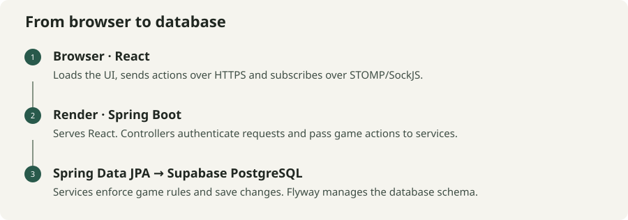
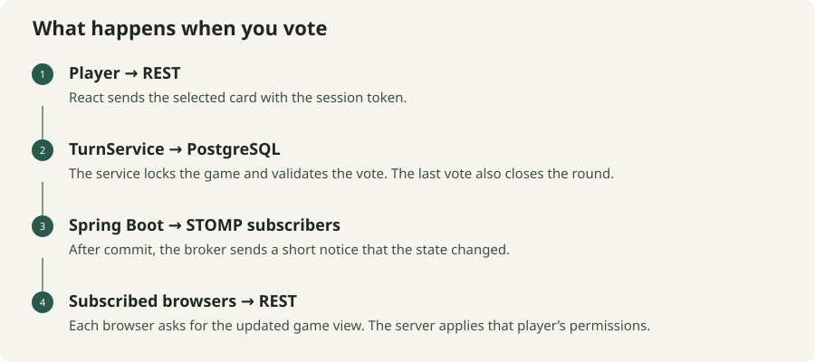
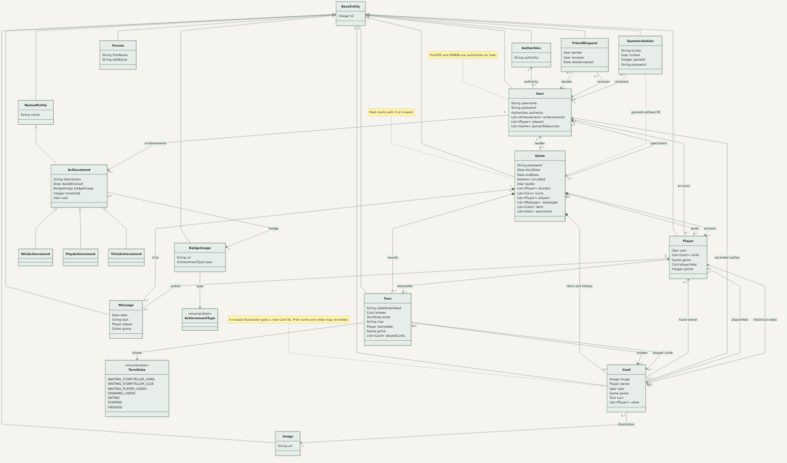

# Dixit Online

Play Dixit with three or four people in a browser. One player picks an illustrated card and gives a clue. Everyone else adds a card that fits the clue, then tries to spot the storyteller’s card among the decoys. The game ends once everyone has been storyteller twice.

[Play Dixit](https://dixit-demo-20261110-g.onrender.com) · [API docs](https://dixit-demo-20261110-g.onrender.com/docs)

The demo runs on Render Free. The first visit can take a few minutes if the server has gone to sleep.

## How it’s built



One Spring Boot application serves the React bundle and the API. The backend runs on Java 21. Its controllers handle HTTP, its services enforce the game rules, and Spring Data JPA handles persistence. In the hosted demo, Flyway manages the schema in PostgreSQL on Supabase. Local development uses an in-memory H2 database.

React renders the table, handles input and keeps things like clue drafts and animation state in the browser. Spring Security verifies the session token, and the game services check whose turn it is, what that player can do and which cards they can use. The server calculates the score and decides when to advance the game.

[Full layer diagram (PNG)](docs/diagrams/layer-diagram.png) · [Mermaid source](docs/diagrams/layer-diagram.mmd)

## What happens when you vote



A vote is a REST request. The server locks the game while it checks the current turn and records the vote. On the last valid vote it also scores the round and either starts the next one or ends the game. Those changes commit together, so two nearly simultaneous requests cannot both close the same round.

STOMP tells the other browsers that something changed. Each browser goes back to the API for its own view. During play you can see your hand and your own vote. The server controls when the answer and the other votes become visible. The same read path lets a browser catch up after reconnecting.

## Why one illustration can have several card IDs

`User` represents an account. `Player` represents a seat in a game and carries the hand and score for that participation. A `Game` has a series of `Turn` records. Each turn keeps the storyteller, clue, cards and votes for that round.

`Image` is the illustration, and `Card` is an individual appearance of that illustration in a game. A four-player match eventually runs out of fresh illustrations. At that point the server can create a card with a new ID using an eligible illustration from an earlier round. The earlier card still carries its own author, turn and votes. Players start each new round with six cards, and the last round skips the refill.

[](docs/diagrams/class-diagram.png)

[Class diagram source](docs/diagrams/class-diagram.mmd) · [Full domain diagram](docs/diagrams/domain-diagram.png)

## Running the demo

Room and turn updates use the in-memory STOMP broker. The server also keeps track of who is connected. If the host briefly drops out, there is a 30-second grace period from the detected disconnect. Other players can reconnect to their existing seats. If the server process itself restarts, active games can be cancelled and the recorded history stays in PostgreSQL.

GitHub Actions checks the frontend and backend, runs tests against isolated PostgreSQL, and verifies the JAR, Docker image and restore procedure. Render updates are manual. During a planned update, maintenance mode blocks new starts so active games can finish before the old process is stopped.

## Run locally

Use Java 21 and the Node version in `frontend/.nvmrc`. From the project root:

```sh
./mvnw spring-boot:run
```

In a second terminal:

```sh
cd frontend
npm ci
npm start
```

Open <http://localhost:3000>. The local database is disposable, so accounts and games can disappear when the backend restarts.

[Setup and tests](docs/local-development.md) · [Architecture and design decisions](docs/architecture.md) · [Operations](docs/README.md)
