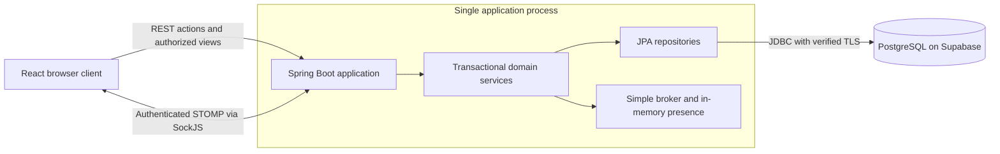

# Current architecture

Documentation baseline: `69b58b49c783c4bd6c222dcc7a79f645ef95951b` (develop, PR #74). Deployment may use an earlier SHA; see the Render runbook.

The diagram describes runtime responsibilities rather than separate deployable services. The application serves React's production build. Supabase supplies PostgreSQL; the application does not delegate login to Supabase Auth or game events to Supabase Realtime.

## Domain and data ownership

`User` identifies an account; `Player` identifies a participation. Statistics and authorization must not substitute one ID for the other. A `Game` contains participants and `Turn` records. `Image` identifies an illustration; `Card` identifies one occurrence within a game. Reusing an image creates a fresh Card rather than erasing historical authorship or votes (ADR-0001).

Three or four players begin turns with six cards. New images are consumed first, then eligible historical images are reused. Active hands and tables are excluded. Replenishment, scoring and advancement are transactional; the final round has no refill. Four-player completion has historically been checked with eight turns and 52 Card occurrences for 36 images.

## Request and event flow

Controllers authenticate/authorize the actor and call domain services. Services enforce membership, phase and ownership, using transactional locks where needed. Repositories persist state. REST views expose only data allowed for the requesting actor and phase; entities are not broadcast as a shared private game graph.

STOMP clients authenticate with JWT, subscribe only to authorized destinations and cannot SEND fabricated state. After a committed action, minimal invalidations cause clients to retrieve fresh authorized REST snapshots. The frontend discards stale responses; reconnecting reloads state rather than replaying commands (ADR-0002/0003).

## Presence and interruption

Account presence and game presence have different meanings. Multiple authenticated sessions can keep an account online; the host's game subscriptions drive the game-disconnection policy. The host has a 30-second grace period from detected disconnection. Explicit host departure or timeout cancels the game, preserving history without new rewards. Another player's seat remains available for their return (ADR-0004/0005).

Presence, deadlines and the broker are in memory. Restart recovery cancels interrupted started games rather than reconstructing live play. ADMIN maintenance prevents new starts/creations while active games finish. PostgreSQL session guards prevent another cooperating runtime cohort from accessing the database simultaneously; they do not promise a single physical JVM or high availability (ADR-0008–0011).

## Persistence and delivery

Local development uses disposable H2. The demo uses PostgreSQL 17, Flyway V1–V3, restricted runtime/migration roles and Hibernate validation. A multistage Docker build packages React with Spring Boot. CI checks tests, real JAR startup, isolated PostgreSQL, restore and actual image behavior. Publication is a separate manual operation, with Auto-Deploy Off and a stop-first replacement procedure.

## Design diagrams

| Diagram | Scope | Editable source |
| --- | --- | --- |
| [Layers](diagrams/layer-diagram.png) | Controllers, services, repositories and query signatures, security, STOMP and runtime operations | [Mermaid](diagrams/layer-diagram.mmd) |
| [Classes](diagrams/class-diagram.png) | Entities, fields, inheritance, enums, associations and multiplicities | [Mermaid](diagrams/class-diagram.mmd) |
| [Domain](diagrams/domain-diagram.png) | How gameplay, cards, chat, accounts and invitations fit together | [Mermaid](diagrams/domain-diagram.mmd) |

Open the PNGs at full size to read the member lists and dependencies. The class diagram includes the persistence model and its inherited fields. The domain diagram focuses on the business relationships, with ADMIN represented by an account authority and invitations linked by a stored game ID. Class fields describe server-side entities. REST response fields follow the projections documented above.
