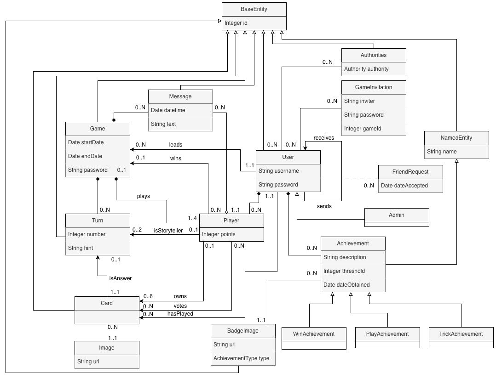

# Analysis of system requirements document

**Subject:** Diseño y Pruebas (Grado en Ingeniería del Software, Universidad de Sevilla)  
**Academic year:** 2025/2026  
**Group/Team:** LI - 02  
**Project name:** Dixit  
**Repository:** [Link](https://github.com/gii-is-DP1/dp1-2025-2026-li-02)  
**Members:** Nicolás de Alba León (PNS5576 / nicdeleo@alum.us.es), Alonso Gudiel Güemes (XSK0385 / alogudgue@alum.us.es), Víctor Martínez Trujillo (
XCN8537 / vicmartru@alum.us.es), Pablo Romero Gómez (GFQ0792 / pabromgom@alum.us.es), Álvaro Vílchez Alejandre (
NYP0448 / alvvilale@alum.us.es)

## Introduction

The project consists of adapting the classic game Dixit into a digital format. This way, it is no longer necessary for
four friends to sit at the same table to enjoy it; instead, four friends separated by kilometers can connect online and
play together in an entertaining way.

With the implementation of Dixit Online, our goal is to allow groups of 3–4 people to connect remotely to the same match
and practice these skills collaboratively.

The gameplay unfolds as follows: once the game begins, each player is dealt six illustrated cards. A storyteller is
chosen (either automatically or in turn order). The storyteller selects one of their cards and provides a creative clue
related to it (this may be a word, sentence, onomatopoeia, etc.). The other players then choose one card from their hand
that could also fit the clue, aiming to mislead the others. The system shuffles all the selected cards (including the
storyteller’s) and displays them anonymously. All players, except the storyteller, vote for the card they believe
belongs to the storyteller. Votes are revealed, cards are uncovered, and points are awarded according to the rules (see
video). Afterward, each player draws a new card to maintain six in hand, the storyteller role passes to the next
player, and the cycle repeats.

A typical game lasts around 25 minutes, depending on the number of players and the pace of the rounds. The game ends
when all players have been the storyteller twice.

The scoring system works as follows:

* If all or none of the players guess the storyteller’s card, the storyteller receives no points, while all other
  players gain 2 points.

* If some (but not all) players guess correctly, the storyteller and each correct guesser receive 3 points, and players
  earn 1 point for every vote cast for their card.

The winner is the player with the highest score at the end of the game.

[Link to the explanation of the game's rules / real game](https://www.youtube.com/watch?v=zkRQlR7Veew)

## Types of users / roles

* Administrator: Developers of Dixit, in this case ourselves, who carry out all the necessary tasks to ensure the game
  runs properly.
* User: Someone with an account that has logged in and has access to the functionalities of the system (stats, creation
  of game, etc.)
* Player: A person currently playing Dixit may either take on the role of storyteller or simply participate as a player
  in the game. In addition, there is one player who creates the room, who will be considered the host. However, during
  the match, the host functions as any other player. The only distinction is that if the host disconnects, the game will
  automatically end.

## User stories

### US1-([ISSUE#29](https://github.com/gii-is-DP1/dp1-2025-2026-li-02/issues/29#issue-3494571983)): Register user

| Description: As a user, I want to register myself with a username to play Dixit games                          | 
|----------------------------------------------------------------------------------------------------------------|
||
| When accessing the page of the user, we introduce the necessary data and then a new user will be created.      |
 ### US2-([ISSUE#30](https://github.com/gii-is-DP1/dp1-2025-2026-li-02/issues/30#issue-3494579634)): List users 
| Description: As an administrator, I want to visualize with pagination all registered users                     | 
|----------------------------------------------------------------------------------------------------------------|
||

### US3-([ISSUE#31](https://github.com/gii-is-DP1/dp1-2025-2026-li-02/issues/31#issue-3494582893)): Users CRUD

| Description: As an administrator, I want to be able to Create, Read, Update and Delete the users, stats, games, etc… of my database and perform safety checks. | 
|----------------------------------------------------------------------------------------------------------------------------------------------------------------|
||
||
||
||

### US4-([ISSUE#32](https://github.com/gii-is-DP1/dp1-2025-2026-li-02/issues/32#issue-3494584605)): Log in

| Description: As a user, i want to log in with my username and password                           | 
|--------------------------------------------------------------------------------------------------|
||

| We enter the necessary information of an already registered user, and then we login to that user |

### US5-([ISSUE#33](https://github.com/gii-is-DP1/dp1-2025-2026-li-02/issues/33#issue-3494585677)): Edit profile

| Description: As a user, I want to edit my personal profile, change my username or my password                                        | 
|--------------------------------------------------------------------------------------------------------------------------------------|
||
| You can change your password and username, and then the information of the user will be updated                                      |

### US6-([ISSUE#34](https://github.com/gii-is-DP1/dp1-2025-2026-li-02/issues/34#issue-3494592039)): Create Lobby

| Description: As a user, I want to create a lobby so other players can join.                                                          | 
|--------------------------------------------------------------------------------------------------------------------------------------|
| |
| We select the option create game and then enter the password for the game, and then the game is created                              |

### US7-([ISSUE#35](https://github.com/gii-is-DP1/dp1-2025-2026-li-02/issues/35#issue-3494593629)): Join a lobby to play

| Description: As a user, I want to join a lobby and play in it.                                                                       | 
|--------------------------------------------------------------------------------------------------------------------------------------|
| |
| We select the option join game, and we enter the password of the lobby we want to join                                               |

### US8-([ISSUE#36](https://github.com/gii-is-DP1/dp1-2025-2026-li-02/issues/36#issue-3494594582)): Start game

| Description: As a host, I want to initiate the game in the lobby so that we can start playing.                                       | 
|--------------------------------------------------------------------------------------------------------------------------------------|
| |
||

| After all players have joined the lobby, we start the game to start playing                                                          |

### US10-([ISSUE#38](https://github.com/gii-is-DP1/dp1-2025-2026-li-02/issues/38#issue-3494602430)): Games in progress

| Description: As an administrator, I want to visualize a list of the games in process, including the host of each game. | 
|------------------------------------------------------------------------------------------------------------------------------------|
||
| You can see the games that are being played clicking on the hisotry option in the bar                                              |

### US11-([ISSUE#39](https://github.com/gii-is-DP1/dp1-2025-2026-li-02/issues/39#issue-3494608985)): Past games register

| Description: As an administrator, I want to have access to a list of past games | 
|----------------------------------------------------------------------------------------------------|
||
| In the history option, you will be able to see all the games that have been played by all users    |

### US12-([ISSUE#40](https://github.com/gii-is-DP1/dp1-2025-2026-li-02/issues/40)): Storyteller's card and clue

| Description: As a storyteller, I want to choose a card of my hand and write a clue. | 
|-------------------------------------------------------------------------------------|
||
||

| An option to write the clue will popup, and at the same time you select your card.  |

### US13-([ISSUE#41](https://github.com/gii-is-DP1/dp1-2025-2026-li-02/issues/41)): Player's card

| Description: As a player, I want to choose a card of my hand that fits the clue. | 
|----------------------------------------------------------------------------------|
||
| The player select his card once he sees the clue the storyteller has written.    |

### US14-([ISSUE#43](https://github.com/gii-is-DP1/dp1-2025-2026-li-02/issues/43)): Show cards in the table

| Description: As a player, I want to see every card that was placed in the table so that I can vote later. | 
|-----------------------------------------------------------------------------------------------------------|
||
| All the cards selected by players are shown in the center of the screen.                                  |

### US15-([ISSUE#42](https://github.com/gii-is-DP1/dp1-2025-2026-li-02/issues/42)): Voting

| Description: As a player, I want to vote for the card that I think the storyteller chose. | 
|-------------------------------------------------------------------------------------------|
||
| The player selects one of the card of the table to vote for it.                           |

### US16-([ISSUE#45](https://github.com/gii-is-DP1/dp1-2025-2026-li-02/issues/45)): Show who voted each card

| Description: As a player, I want to know who the votes of a card | 
|-------------------------------------------------------------------|
||
| The voting count is put next to each card.                        |

### US18-([ISSUE#47](https://github.com/gii-is-DP1/dp1-2025-2026-li-02/issues/47)): See my cards

| Description: As a players, I want to see only the cards of my hand.                                                                 | 
|-------------------------------------------------------------------------------------------------------------------------------------|
||
| You see your own hand while you are playing.                                                                                        |

### US19-([ISSUE#48](https://github.com/gii-is-DP1/dp1-2025-2026-li-02/issues/48)): Show the winner

| Description: As a player, I want to know the winner after the game ends. | 
|--------------------------------------------------------------------------|
||
| Once the game is finished, a sign is shown telling who is the winner.    |

### US20-([ISSUE#49](https://github.com/gii-is-DP1/dp1-2025-2026-li-02/issues/49)): Log out

| Description: As a user, I want to log out when I'm done playing.        | 
|-------------------------------------------------------------------------|
||

| After accepting the logging out, you will be kicked out of your session |

### US21-([ISSUE#50](https://github.com/gii-is-DP1/dp1-2025-2026-li-02/issues/50)): Games statistics

| Description: As a user, I want to see the statistics of my games | 
|--------------------------------------------------------------------------------------------------------------------------------|
||
| In the history view, you will be able to see all information related to a game.                                                |

### US22-([ISSUE#51](https://github.com/gii-is-DP1/dp1-2025-2026-li-02/issues/51)): User rankings

| Description: As a user, I want to see myself ranked based on the different stats with my friends. | 
|-------------------------------------------------------------------------------------------------------|
||

### US23-([ISSUE#54](https://github.com/gii-is-DP1/dp1-2025-2026-li-02/issues/54)): Complete achievements

| Description: As a user, I want to be see the achievements I have earned. | 
|--------------------------------------------------------------------------------|
||

### US24-([ISSUE#53](https://github.com/gii-is-DP1/dp1-2025-2026-li-02/issues/53)): Listing locked achievements

| Description: As a user, I want to list the achievements to be completed and their information. | 
|------------------------------------------------------------------------------------------------------------------|
||
| Clicking achievements on the bar, will redirect you to all the achievements available  |

### US25-([ISSUE#55](https://github.com/gii-is-DP1/dp1-2025-2026-li-02/issues/55)): Send invitations

| Description: As a player, I want to invite friends to my game, either as a player. | 
|-----------------------------------------------------------------------------------------------|
||

### US26-([ISSUE#56](https://github.com/gii-is-DP1/dp1-2025-2026-li-02/issues/56)): Receive invitations

| Description: As a user, I want to be able to receive invitations to my friends' games. | 
|----------------------------------------------------------------------------------------|
||

### US27-([ISSUE#57](https://github.com/gii-is-DP1/dp1-2025-2026-li-02/issues/57)): Spectator mode

| Description: As a user, I want to watch a game of other players without playing, as long as all the players are my friends. | 
|-----------------------------------------------------------------------------------------------------------------------------|
||
||

### US28-([ISSUE#58](https://github.com/gii-is-DP1/dp1-2025-2026-li-02/issues/58)): Comments and public chat

| Description: As a player, I want to make comments and communicate through a chat during games. | 
|------------------------------------------------------------------------------------------------|
||

## Conceptual diagram of the system

## Business rules

### R1 - Game system

One of the players is the storyteller, who has to come up with a theme matching one of his cards and put it upside down.
After that, the rest of the players must choose a card from his own deck that fits best the theme chosen.

### R2 - First storyteller

In the first turn, the storyteller is selected randomly.

### R3 - Player's hand

Each player must have 6 cards on its own deck at all time during the game.

### R4 - Votation system

Every player except from the storyteller must vote a card that is not their owns.

### R5 - Scoring system

If everyone or no one voted for the storyteller card, everyone except him wins 2 points. Otherwise, the storyteller and
each of the players that voted his card wins 3 points.

### R6 - Extra points

Each player that is not the storyteller wins 1 point for each one that voted his card.

### R7 - End of turn

The cards that are not in the players’ deck are shuffled and then each player takes 1 to have 6 cards again. The player
to the left of the storyteller is the storyteller of the next turn.

### R8 - End of game

The game finishes when all players have been the storyteller twice.

### R9 - Winner

The player with the most points wins the game.

### R10 - Starting the game

A game can only be started by the host once there are 3 or 4 players, including the host.

