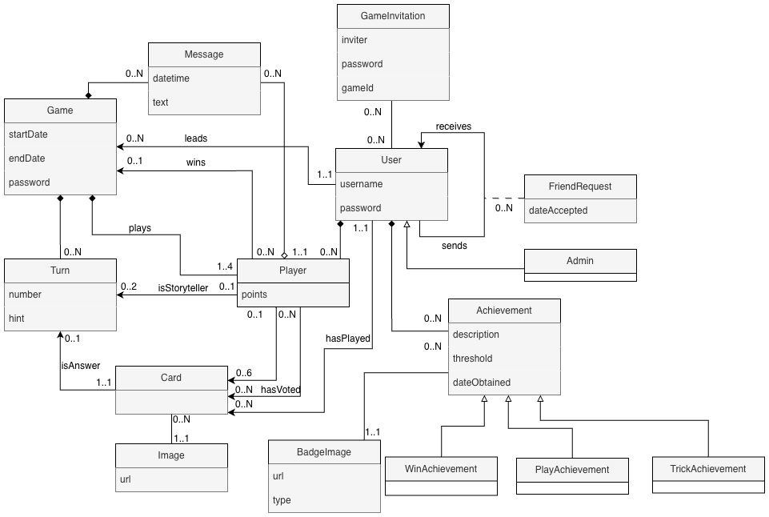
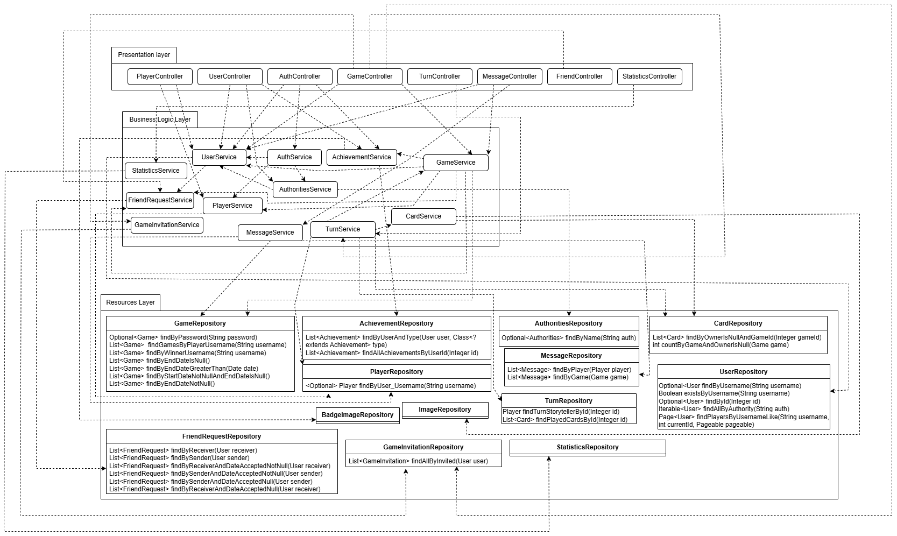
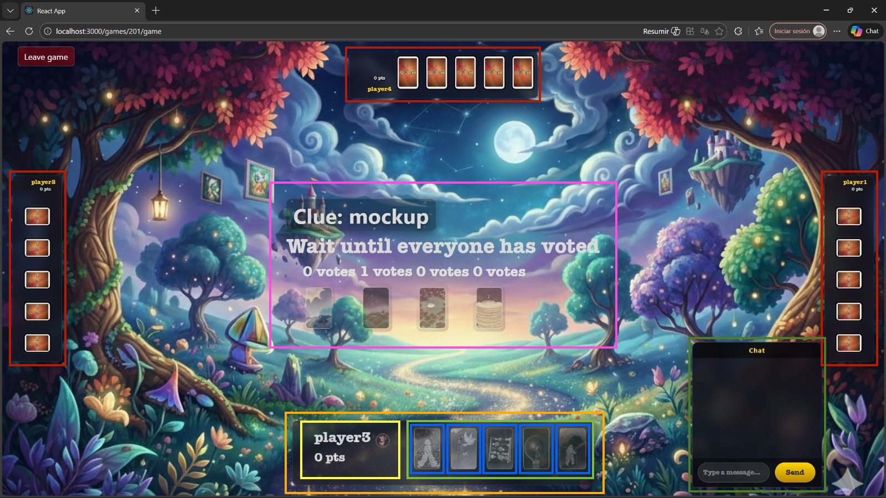

# System design document

**Subject:** Diseño y Pruebas (Grado en Ingeniería del Software, Universidad de Sevilla)  
**Academic year:** 2025/2026 <!-- p.ej., 2025/2026 -->  
**Group/Team:** LI - 02<!-- p.ej., L4-03 Equipo 33 -->  
**Project name:** Dixit <!-- p. ej. Petris -->  
**Repository:** [Link](https://github.com/gii-is-DP1/dp1-2025-2026-li-02) <!-- URL del repo -->  
**Members:** Nicolás de Alba León (PNS5576 / nicdeleo@alum.us.es), Alonso Gudiel Güemes (XSK0385 / alogudgue@alum.us.es), Víctor Martínez Trujillo (
XCN8537 / vicmartru@alum.us.es), Pablo Romero Gómez (GFQ0792 / pabromgom@alum.us.es), Álvaro Vílchez Alejandre (
NYP0448 / alvvilale@alum.us.es)<!-- Nombre Apellidos (US-Id / correo @us.es) -->

## Introduction

The project consists of adapting the classic game Dixit into a digital format. This way, it is no longer necessary for
four friends to sit at the same table to enjoy it; instead, four friends separated by kilometers can connect online and
play together in an entertaining way.

With the implementation of Dixit Online, our goal is to allow groups of 3–4 people to connect remotely to the same match
and practice these skills collaboratively.

The gameplay unfolds as follows: once the game begins, each player is dealt six illustrated cards. A storyteller is
chosen (either automatically or in turn order). The storyteller selects one of their cards and provides a creative clue
related to it (this may be a word, sentence, onomatopoeia, etc.). The other players then choose one card from their hand
that could also fit the clue, aiming to mislead the others. The system shuffles all the selected cards (including the
storyteller’s) and displays them anonymously. All players, except the storyteller, vote for the card they believe
belongs to the storyteller. Votes are revealed, cards are uncovered, and points are awarded according to the rules (see
video). Afterward, each player draws a new card to maintain six in hand, the storyteller role passes to the next
player, and the cycle repeats.

A typical game lasts around 25 minutes, depending on the number of players and the pace of the rounds. The game ends
when all players have been the storyteller twice.

The scoring system works as follows:

* If all or none of the players guess the storyteller’s card, the storyteller receives no points, while all other
  players gain 2 points.


* If some (but not all) players guess correctly, the storyteller and each correct guesser receive 3 points, and players
  earn 1 point for every vote cast for their card.

The winner is the player with the highest score at the end of the game.

[Link to the explanation of the game's rules / real game](https://www.youtube.com/watch?v=zkRQlR7Veew)

## UML diagram(s):

### Domain/design diagram



### Layer Diagram (including controllers, services and repositories)



## Decomposition in components of the game board



- Game - main component
    - $\color{red}{\textsf{Other Player Panel - Panel containing the information and cards of an opponent, including the points and a badge if they're the storyteller. There are three variants. }}$
    - $\color{orange}{\textsf{Own Player Panel - Area showing the information of the user}}$
        - $\color{yellow}{\textsf{User information - Container displaying the points and an image if the user is the turn's storyteller. }}$  
        - $\color{green}{\textsf{Deck - Array of cards }}$
          - $\color{darkblue}{\textsf{Card - Button that choose the card to play, either setting it as storyteller (answer) or as a player }}$
    - $\color{darkgreen}{\textsf{Chat - Component displaying the game chat for the players.}}$
    - $\color{purple}{\textsf{Turn Status Panel - Main component in charge of displaying the turn state and the instructions. Depending on the state, cards can be shown for voting or setting the answer, a text field for setting the clue, etc.}}$

## Design and architectural patterns applied

### Pattern: Layered Architecture

*Type*: Architectural

*Application Context*
Following the structure shown in the subject, our application is organized into three horizontal layers. Each layer has
a specific responsibility and communicates only with adjacent layers.

* **Presentation Layer:** Responsible for presenting information to and interacting with the user through the graphical
  user interface. In our project, this consists of the **React Frontend** (UI) and the **REST Controllers**.
* **Business Logic Layer:** It processes presentation layer requests, performs calculations and operations (e.g.
  authentication), and moves data between presentation and resource layers. This is implemented in our **Service Layer
  ** (e.g. `TurnService`, `GameService`), which orchestrates the game logic.
* **Resource Layer:** Responsible for managing persistent data. This is handled by our **Repositories** (Spring Data
  JPA) and the underlying database.

*Classes or packages created*

* **Presentation:** All controller classes and the client-side React application.
* **Business Logic:** All service classes (containing all business rules).
* **Resource:** Repositories classes and the domain Entities.

*Advantages achieved by applying the pattern*
It promotes high **maintainability** and **scalability**. Changes in one layer (e.g., changing the database engine in
the Resource layer) do not impact the Business Logic or Presentation layers, as long as the interfaces remain
consistent. It also makes the codebase easier to navigate for new developers.

### Pattern: Model-View-Controller (MVC)

*Type*: Architectural

*Application Context*
This pattern is the fundamental architectural basis of our backend developed with Spring Boot. It separates the
application logic into three interconnected elements:

* **Model:** Represents the data and business rules. It encapsulates **Entities** (State), **Repositories** (Data
  Access), and **Services** (Logic).
* **View:** In our context (REST API), the view is the **JSON representation** of the data returned to the client. It is
  decoupled from the user interface (JS/CSS).
* **Controller:** Handles incoming HTTP requests, invokes the business logic (Service), and determines the response data
  to send back.

*Classes or packages created*

* **Controllers:** All controllers in the project (e.g. `GameRestController`, `TurnController`).
* **Model:** All Entities, Services, and Repositories.
* **View:** The **DTOs (Data Transfer Objects)** and the JSON serialization configurations via annotations in the
  Entities.

*Advantages achieved by applying the pattern*
It allows a clear **Separation of Concerns (SoC)**. The business logic (Model) is independent of the external
interface (Controller/View). This facilitates maintenance, as changing the API endpoint definition does not require
changing the business rules, and vice versa. It also allows multiple developers to work on different layers
simultaneously.

### Pattern: Dependency Injection

*Type*: Design

*Application Context*
We apply this pattern throughout the Spring Boot container to manage dependencies between components. Instead of classes
instantiating their own dependencies (e.g., a Controller creating a `new Service()`), the framework injects the
necessary instances at runtime.

*Classes or packages created*

* **Services:** All services (They are injected into controllers).
* **Repositories:** All repositories (They are injected into services).
* **Controllers:** All controllers (They receive the services via constructor).

*Advantages achieved by applying the pattern*

* **Loose Coupling:** Classes do not depend on concrete implementations of other classes, but on abstractions or beans
  managed by the container.
* **Testability:** This is the biggest advantage. By injecting dependencies, we can easily inject **Mock** objects (
  using Mockito) during Unit Tests (e.g. inserting a mocked Repository to carry out tests for the corresponding service)

### Pattern: Proxy

*Type*: Structural (Design)

*Application Context*
This pattern is applied implicitly but in our whole project by Spring.
When we annotate a method in a service with `@Transactional`, Spring wraps the service in a **Proxy**. This Proxy
intercepts the call, opens a database transaction, runs our code, and then commits or rolls back the transaction. The
client (Controller) talks to the Proxy, thinking it is the real Service.

*Classes or packages created*

* **Services:** All services. Specifically, methods annotated with `@Transactional`.
* **Repositories:** Interfaces extending `CrudRepository` (Spring creates a proxy implementation of these interfaces at
  runtime).

*Advantages achieved by applying the pattern*
The main advantage is that it saves us from writing a lot of repetitive code. For example, instead of manually opening
and closing database transactions in every single method of our services, the proxy handles it automatically just by
using the @Transactional annotation. This keeps our code much cleaner and focused on the game logic rather than on
database management.

### Pattern: Domain Model

*Type*: Design / Architectural

*Application Context*
We have implemented a **Rich Domain Model** to represent the business entities of the game. Instead of having simple
data containers, our entities encapsulate the state and the relationships between them (e.g. a `Turn` belongs to a
`Game`). This model maps directly to the database structure using **JPA (Java Persistence API)** annotations.

*Classes or packages created*

* **Domain Entities:** All Entity classes in Java.
* **Relationships:** defined via annotations like `@OneToMany`, `@ManyToOne`, and `@ManyToMany`.

*Advantages achieved by applying the pattern*
It allows us to think in terms of **Object-Oriented Programming** rather than SQL tables. It ensures data integrity
through strong typing and defined relationships. Furthermore, using JPA allows us to validate the state of these
objects (e.g., `@NotNull`, `@Size`) directly within the domain classes.

### Pattern: Front Controller (via Dispatcher Servlet)

*Type*: Architectural / Design (Presentation)

*Application Context*
We utilize the **Front Controller** pattern, which is implemented in Spring Boot by the `DispatcherServlet`. This
servlet acts as the **single entry point** for all incoming HTTP requests to our application. Instead of having multiple
servlets for different URLs, the Dispatcher Servlet intercepts every request, determines which specific Controller has
to handle it (based on the URL and HTTP method), and delegates the processing to that controller.

*Classes or packages created*

* **Infrastructure:** The `DispatcherServlet` is provided and autoconfigured by the Spring Boot framework at startup.
* **Delegates:** All our custom controllers act as the handlers that the Front Controller delegates to.

*Advantages achieved by applying the pattern*

* **Centralized Request Handling:** It provides a central place to handle common logic such as routing, security,
  internalization, and global error handling, ensuring consistency across the application.
* **Simplified Controllers:** Our individual controllers do not need to handle raw HTTP servlet requests; they can focus
  purely on business logic and return simple POJOs (Plain Old Java Objects) or DTOs, while the Front Controller handles
  the heavy lifting of request/response conversion.

### Pattern: Service Layer

*Type*: Architectural

*Application Context*
This pattern defines a set of available operations that stand as a boundary between the presentation layer (Controllers)
and the domain/data layer. In our architecture, the **Service Layer** encapsulates the application's business logic,
such as calculating scores, managing turn transitions, or validating game rules. It ensures that the Controllers remain
focused only on the API operations.

*Classes or packages created*

* **Services:** All Service classes.

*Advantages achieved by applying the pattern*

* **Reusability:** The business logic contained in a service can be called from multiple controllers or other services
  without repeating code (DRY principle).
* **Transaction Management:** This is the ideal place to make our logic transactional, ensuring that complex operations
  are either completed fully or rolled back entirely.
* **Separation of Concerns:** It isolates the business rules from both the web layer and the database access details.

### Pattern: Data Mapper (via Metadata Mapping)

*Type*: Architectural / Structural

*Application Context*
We implement the **Data Mapper** pattern using **Metadata Mapping** to handle the communication between the in-memory
objects and the relational database. Instead of writing manual SQL queries or JDBC code to move data, we use **JPA
Annotations** (Metadata) such as `@Entity`, `@Table`, `@ManyToOne`, and `@Id`. The ORM framework (Hibernate) reads this
metadata to automatically map database rows to Java objects and vice versa.

*Classes or packages created*

* **Domain Entities:** All Entity classes. These implement the data mappers configuration via annotations.
* **Repositories:** The Spring Data interfaces facilitate the execution of this mapping.

*Advantages achieved by applying the pattern*

* **Decoupling:** The domain model is independent of the database code. We can change the database implementation with
  minimal impact on the Java classes.
* **Productivity:** It drastically reduces repeated code. We do not need to write manual CRUD SQL statements, everything
  is done automatically.
* **Maintainability:** With the annotations it is easier to understand the relationship between the object model and the
  data model.

*

## Design decisions

### Decision 1: Entering lobbies through password

#### Problem description:

We will like to make available entering lobbies through different methods. They are, through invitations and a password.
The password arises some problems, like the uniqueness of it and how we are going to handle the way of entering a game
through it.

#### Alternatives:

*Alternative 1.a*: Making the password unique.

*Advantages:*
• No games playing at the same time could have the same password.
*Drawbacks:*
• No more games with the same password can be created, even if the game with the password has finished.

*Alternative 1.b*: We introduce the game id and the password if it has any.
*Advantages:*
• Games with the same password can be created.
*Drawbacks:*
• We also need to know the id of the game to enter it thorugh this method.

*Justification of the proposed alternative*
As we see that knowing the id could be easily displayed in the frontend so you can say the id to your friends apart from
the password, we chose 1.b.


### Decision 2: Creating a system to store information about cards.

#### Problem description:

We want to create a system to know which cards are in the hand of a player and which cards are used in a turn.

#### Alternatives:

*Alternative 2.a*: Creating relations to store the data in the database.

When a game is created, 36 card objects are stored in the database. These 36 cards have the game_id of the created game,
and an empty player_id and turn_id. When we deal a card, we change the player_id of the card to the id of the player
that has been given it. We can only deal cards that have a null player_id, as it means that that card hasn't been given
to any player, and that have the game_id of the game that is being played. Finally, the turn_id will be set when a
player plays a card in a turn. That way, we can know for each turn, what card has been played and by what players.

*Justification of the proposed alternative*
The alternative 2.a gives us all the data that we need to make the game logic work. After testing all the services
we found out that this model is the one that works the best.

### Decision 3: Separating card images from card objects.

#### Problem description:

We want to make it so that when we create a game, we create 36 card objects and for each of these cards, we associate
them to the game id. Each of this cards must have an image, which is a long URL.

#### Alternatives:

*Alternative 3.a*: Making an image class that associates each card image to an id. When we create the cards for a game,
we only have to put an id from 0 to 35 to each one of them.

*Alternative 3.b*: Everytime that we create the deck for game, associate each card to a long URL.

*Justification of the proposed alternative*
We chose alternative 3.a as it made the code much cleaner and it made it easier for future updates, if we want to
increase the number of available cards. The only downside is that we made our class diagram more complex as we added a
new class Image that gives information to the class Card.

### Decision 4: Managing friends

#### Problem description:

We want to allow users to add, remove and see a list of friends.

#### Alternatives:

*Alternative 4.a*: Adding a list of friend users to the User class. Adding a user as friend would only require to know
its id.

*Advantages*:
• It is simple to implement

*Drawbacks*
• Users can't decide if they want to be friends or not, they only can remove the friend from the list, but they can be
added back without consent.

*Alternative 4.b*: Adding a new class FriendRequest with a sender and a receiver.

*Advantages*:
• Users can decide if they want to accept or not the request.
• Requests can be listed and filtered by state.
• We can add information to requests, such as when it was approved.

*Disadvantages*
• Need to add a new class.
• It is more difficult to list a user's friends since the user can be either the sender or the receiver.
• More complex validation:

*Justification of the chosen alternative*
Even though the second alternative is more difficult to implement, it gives more flexibility and control that users
should have.

### Decision 5: Creating a separate package for statistics.

#### Descripción del problema:

We want to add the statistics module to our project.

#### Alternativas de solución evaluadas:

*Alternative 5.a*: Creating the whole code in package Game.
We could create the whole functionality in the game package as the statistics are based on the Game entity.

*Alternative 5.b*: Creating a separate package for statistics module.
We could create a separate package for the statistics, liberating the game package from so much code and grating
modularity.

*Justificación de la solución adoptada*
The alternative 5.b was the adopted one since it made more sense, was more optimal in terms of modularity, coupling and
coherence and also made our project more intuitive.

### Decision 6: Creating a DTOs for the responses of the methods in our statistics' controller.

#### Descripción del problema:

We want to send the statistics data to the frontend but we are evaluating the format.

#### Alternativas de solución evaluadas:

*Alternative 6.a*: Creating DTOs for GlobalStats, UserStats and RankingData.
We could send the data to the frontend just including all the stats. classified by type (global, ranking and user). It
was pretty optimal and also implements the state pattern in which depending the data we want we send it one way or
another.

*Alternative 6.b*: Sending the data in a raw way in many controller methods.
We could send the data in many controller methods (bigger controller).

*Justificación de la solución adoptada*
The alternative 6.a was the adopted one since it made more sense, was more optimal in terms of performance and also made
our controller so much cleaner.

### Decision 7: Creating all the stats in the same screen but changing data with tabs.

#### Descripción del problema:

We want to make visible the statistics in the frontend.

#### Alternativas de solución evaluadas:

*Alternative 7.a*: Having different independent statistics screens depending on the type of stats.
We could have distributed screens of the different types of stats

*Alternative 7.b*: Creating a common screen for all stats changing data with tabs.
We could create a single screen encapsulating three tabs with the different types of statistics allowing the user to
select which one to visualize.

*Justificación de la solución adoptada*
The alternative 7.b was the adopted one since it seemed more professional to us, and it remained optimal since we
continued having components for the different types of stats.

### Decision 8: Performing queries with a function inside to get the time statistics

#### Descripción del problema:

We want to get statistics for time played, longest game etc.

#### Alternativas de solución evaluadas:

*Alternative 8.a*: Doing more complex queries including the function timediff to compute timings.
We could subtract the end and start times of games to get duration data in every query.

*Alternative 8.b*: Creating a new attribute duration in Game Entity.
We could add a new attribute called duration which would have been a derived property computed from startDate and
endDate attributes.

*Justificación de la solución adoptada*
The alternative 8.a was the adopted one since it was too late for changing the Game.js Entity, which could make us have
plenty of new bugs. To us, it seemed to risky, and it was not so suboptimal so we chose this alternative.

### Refactorization 1:

Here we tried to fix some bad practices that were applied making the code less reusable, understandable and clear.
All the logic of creating and joining a game was inside the GameRestController, which should only get the entities and
send them to the GameService.
Also, some validations and checks were repeated inside the service methods, functions could be simplified and common
parts could be externalized.
Exception handling was also added and improved over the whole project.
We can find the changes from commit [decdfc49](https://github.com/gii-is-DP1/dp1-2025-2026-li-02/commit/decdfc49).

#### Initial state of the code

```java

@PostMapping
@ResponseStatus(HttpStatus.CREATED)
public ResponseEntity<Game> create(@RequestBody HashMap<String, String> body) {
    String password = body.get("password");
    User currentUser = userService.findCurrentUser();
    Game game = new Game();
    game.setPassword((password != null && !password.isBlank()) ? password : null);
    Player leader = new Player();
    leader.setUser(currentUser);
    leader.setGame(game);
    game.setLeader(leader);
    game.getPlayers().add(leader);
    Game savedGame = gameService.saveGame(game);
    return new ResponseEntity<>(savedGame, HttpStatus.CREATED);
}


@PatchMapping("/{id}/join")
@ResponseStatus(HttpStatus.OK)
public ResponseEntity<?> joinGame(@PathVariable("id") Integer id, @RequestBody HashMap<String, String> body) {
    Game game = gameService.findById(id);
    if (game == null) {
        return new ResponseEntity<>("Game not found", HttpStatus.NOT_FOUND);
    }

    if (game.getPlayers().size() >= 4) {
        return new ResponseEntity<>("Already 4 players in the game", HttpStatus.FORBIDDEN);
    }
    String username = userService.findCurrentUser().getUsername();

    boolean alreadyInGame = game.getPlayers().stream()
            .anyMatch(p -> p.getUser().getUsername().equals(username));
    if (alreadyInGame) {
        return new ResponseEntity<>("You are already in this game", HttpStatus.CONFLICT);
    }

    String inputPassword = body.get("password");
    String realPassword = game.getPassword();

    if (realPassword != null && !realPassword.isBlank()) {
        if (!realPassword.equals(inputPassword)) {
            return new ResponseEntity<>("Incorrect password", HttpStatus.UNAUTHORIZED);
        }
    }

    Player player = new Player();
    player.setUser(userService.findCurrentUser());
    player.setGame(game);

    boolean added = gameService.addPlayerToGame(game, player);
    if (!added) {
        return new ResponseEntity<>("You are already in this game", HttpStatus.CONFLICT);
    }

    Game updated = gameService.saveGame(game);
    return new ResponseEntity<>(updated, HttpStatus.OK);
}
```

### State of the refactored code

Now the logic is much easier to understand, reusable and located where the logic should be.

```java    

@PostMapping
@ResponseStatus(HttpStatus.CREATED)
public ResponseEntity<Game> create(@RequestBody HashMap<String, String> body) {
    String password = body.get("password");
    User currentUser = userService.findCurrentUser();
    Game game = gameService.createGame(password, currentUser);

    Game savedGame = gameService.saveGame(game);
    return new ResponseEntity<>(savedGame, HttpStatus.CREATED);
}

@PatchMapping("/{id}/join")
@ResponseStatus(HttpStatus.OK)
public ResponseEntity<?> joinGame(@PathVariable("id") Integer id, @RequestBody HashMap<String, String> body) {
    Game game = null;
    try {
        game = gameService.findById(id);
        User currentUser = userService.findCurrentUser();

        String inputPassword = body.get("password");
        String realPassword = game.getPassword();

        if (realPassword != null && !realPassword.isBlank()) {
            if (!realPassword.equals(inputPassword)) {
                return new ResponseEntity<>("Incorrect password", HttpStatus.UNAUTHORIZED);
            }
        }

        gameService.addPlayerToGame(game, currentUser);

    } catch (Exception e) {
        switch (e) {
            case ResourceNotFoundException resourceNotFoundException -> {
                return new ResponseEntity<>("Game not found", HttpStatus.NOT_FOUND);
            }
            case TooManyPlayersException tooManyPlayersException -> {
                return new ResponseEntity<>("Already 4 players in the game", HttpStatus.FORBIDDEN);
            }
            case PlayerAlreadyInGameException playerAlreadyInGameException -> {
                return new ResponseEntity<>("You are already in this game", HttpStatus.CONFLICT);
            }
            default -> {
                return new ResponseEntity<>(HttpStatus.BAD_REQUEST);
            }
        }
    }


    Game updated = gameService.saveGame(game);
    return new ResponseEntity<>(updated, HttpStatus.OK);
}
```

```java

@Transactional(readOnly = true)
public Game findByIdIfUserInGame(Integer gameId, User user) {
    Game game = gameRepository.findById(gameId)
            .orElseThrow(() -> new ResourceNotFoundException("Game", "id", gameId));
    if (playerInGame(game, user)) {
        return game;
    } else {
        throw new AccessDeniedException("You are not part of this game");
    }
}

@Transactional
public Game createGame(String password, User user) {
    Game game = new Game();
    game.setPassword((password != null && !password.isBlank()) ? password : null);
    game.setLeader(user);
    Player player = new Player();
    player.setUser(user);
    player.setGame(game);
    playerService.savePlayer(player);
    game.getPlayers().add(player);
    return gameRepository.save(game);
}

@Transactional(rollbackFor = {PlayerAlreadyInGameException.class, TooManyPlayersException.class})
public void addPlayerToGame(Game game, User user) throws PlayerAlreadyInGameException, TooManyPlayersException {
    Player player = new Player();
    player.setGame(game);
    player.setUser(user);
    playerService.savePlayer(player);

    if (playerInGame(game, user)) {
        throw new PlayerAlreadyInGameException();
    }
    if (game.getPlayers().size() >= 4) {
        throw new TooManyPlayersException();
    }

    game.getPlayers().add(player);
    gameRepository.save(game);
}

@Transactional(readOnly = true)
public boolean playerInGame(Game game, User user) {
    return game.getPlayers().stream()
            .anyMatch(p -> p.getUser().getId().equals(user.getId()));
}
```

### Refactoring 2:

In this refactoring, we distributed the large amount of lines of code that existed in `TurnService` across the different
entities of our code. Specifically, we distributed part of our logic into the `Turn`, `Game`, and `Player` classes. We
also added code fragments to the `TurnController`. All of this can be better appreciated in the commit with identifier "
af8e290".

#### Initial Code State

```Java 
import org.springframework.transaction.annotation.Transactional;

import java.util.Collections;
import java.util.HashMap;
import java.util.List;
import java.util.Map;
import java.util.Objects;

import java.util.concurrent.ThreadLocalRandom;
import java.util.stream.Collectors;

@ @ -53,25+53,17@@

public List<Card> findPlayedCards(Integer id) {
}

@Transactional(readOnly = true)
public Game findGameById(Integer turnId) {
    Turn turn = findById(turnId);
    return turn.getGame();
}

@Transactional(readOnly = true)
public List<Player> findPlayersNotStoryteller(Integer turnId) {
    Storyteller storyteller = findStoryteller(turnId);
    Game game = findGameById(turnId);
    return game.getPlayers().stream()
            .filter(player -> !player.getId().equals(storyteller.getId()))
            .collect(Collectors.toList());
}

    /*@Transactional(readOnly = true)
    public List<Turn> findGameTurns(Integer id) {
        return turnRepository.findAllTurnsByGameId(id);
    }*/


@Transactional
public Turn saveTurn(Turn turn) throws DataAccessException {
    @ @ -89, 27 + 81, 14 @@public Turn updateTurn (@Valid Turn turn, Integer idToUpdate){
    }

    @Transactional
    public Turn setStorytellerAnswer (Integer turnId, Integer cardId){
        Turn turn = turnRepository.findById(turnId)
                .orElseThrow(() -> new ResourceNotFoundException("Turn", "id", turnId));

        Card card = cardRepository.findById(cardId)
                .orElseThrow(() -> new ResourceNotFoundException("Card", "id", cardId));

        turn.setAnswer(card);
        TurnState newState = TurnState.WAITING_STORYTELLER_CLUE;
        turn.setState(newState);
        return turnRepository.save(turn);
    }

    @Transactional
    public Turn setStorytellerClue (Integer turnId, String clue){
        Turn turn = turnRepository.findById(turnId)
                .orElseThrow(() -> new ResourceNotFoundException("Turn", "id", turnId));

        turn.setClue(clue);
        TurnState newState = TurnState.WAITING_PLAYER_CARDS;
        turn.setState(newState);
        return turnRepository.save(turn);
    }

    @ @ -118, 175 + 97, 55 @@public Turn setStorytellerClue (Integer turnId, String clue){
        public Turn initializeFirstTurn (Game game){
            Turn turn = new Turn();
            turn.setGame(game);
            List<Player> players = game.getPlayers();
            // Assign a random storyteller
            int randomIndex = ThreadLocalRandom.current().nextInt(players.size());
            Player storyteller = players.get(randomIndex);
            turn.setStoryteller(storyteller);
            turn.setState(TurnState.WAITING_STORYTELLER_CARD);
            // Deal 6 cards to each player if possible
            List<Card> deck = cardRepository.findByOwnerIsNullAndGameId(game.getId());
            Collections.shuffle(deck); // Shuffle the deck before dealing
            for (Player player : players) {
                for (int i = 0; i < 6; i++) {
                    if (deck.isEmpty()) break;
                    Card cardToDeal = deck.remove(0);
                    cardToDeal.setOwner(player);
                    cardRepository.save(cardToDeal);
                    player.getCards().add(cardToDeal); // Also add to player's hand to keep in sync
                }
                playerRepository.save(player);
            }
            turnRepository.save(turn);
            return turn;
        }

        @Transactional
        public Card playerPlayCard (Integer turnId, Integer cardId, Integer playerId){
            Turn turn = turnRepository.findById(turnId)
                    .orElseThrow(() -> new ResourceNotFoundException("Turn", "id", turnId));

            Card card = cardRepository.findById(cardId)
                    .orElseThrow(() -> new ResourceNotFoundException("Card", "id", cardId));

            // Validate that card belongs to the player
            if (card.getOwner() == null || !card.getOwner().getId().equals(playerId)) {
                throw new IllegalArgumentException("Card does not belong to the player");
            }

            // Set the card's turn to the current turn
            card.setTurn(turn);

            // Add card to turn's played cards list
            turn.getPlayedCards().add(card);

            // Save the card
            cardRepository.save(card);

            // Check if all players have played, and if so, transition to SHOWING_CARDS
            checkAndTransitionToShowCards(turn);

            return card;
        }

        @Transactional
        public void checkAndTransitionToShowCards (Turn turn){
            // Get the game from the turn
            Game game = turn.getGame();
            if (game == null) {
                return;
            }

            // Count the number of players (excluding the storyteller)
            int totalPlayers = game.getPlayers().size();
            int expectedCardCount = totalPlayers - 1; // All except storyteller

            // Check if all players (except storyteller) have played a card
            if (turn.getPlayedCards().size() == expectedCardCount) {
                turn.setState(TurnState.SHOWING_CARDS);
                turnRepository.save(turn);
            }
        }

        @Transactional
        public Player playerVote (Integer turnId, Integer playerId, Integer cardId){
            Turn turn = turnRepository.findById(turnId)
                    .orElseThrow(() -> new ResourceNotFoundException("Turn", "id", turnId));

            Player player = playerRepository.findById(playerId)
                    .orElseThrow(() -> new ResourceNotFoundException("Player", "id", playerId));

            Card card = cardRepository.findById(cardId)
                    .orElseThrow(() -> new ResourceNotFoundException("Card", "id", cardId));

            // Validate that the card is one of the played cards in this turn
            boolean cardPlayed = turn.getPlayedCards().stream()
                    .anyMatch(c -> c.getId().equals(card.getId()));
            if (!cardPlayed) {
                throw new IllegalArgumentException("Card is not part of this turn's played cards");
            }


            // Set the player's vote
            player.setPlayerVote(card);
            Player saved = playerRepository.save(player);

            // After saving the vote, check whether all players have voted and transition
            checkAndTransitionToScoring(turn);

            return saved;
        }

        @Transactional
        public void checkAndTransitionToScoring (Turn turn){
            Game game = turn.getGame();
            if (game == null) return;

            // Count players excluding storyteller
            int totalPlayers = game.getPlayers().size();
            int expectedVotes = totalPlayers - 1; // everyone except storyteller votes

            // Count votes that are for cards belonging to this turn
            long votes = game.getPlayers().stream()
                    .filter(p -> p.getPlayerVote() != null
                            && p.getPlayerVote().getTurn() != null
                            && p.getPlayerVote().getTurn().getId().equals(turn.getId()))
                    .count();

            if (votes == expectedVotes) {
                turn.setState(TurnState.SCORING);
                turnRepository.save(turn);
            }


        }

        //Scoring method
        @Transactional
        public Turn scoreTurn (Integer turnId){
            Turn turn = turnRepository.findById(turnId)
                    .orElseThrow(() -> new ResourceNotFoundException("Turn", "id", turnId));

            Card storytellerCard = turn.getAnswer();
            if (storytellerCard == null) {
                throw new IllegalStateException("Storyteller card must be set before scoring");
            }
            List<Player> playersNotStoryteller = findPlayersNotStoryteller(turnId);
            Player storyteller = turn.getStoryteller();

            Map<Card, Long> votesPerCard = countVotes(playersNotStoryteller, turnId);
            long votesForStorytellerCard = votesPerCard.entrySet().stream()
                    .filter(entry -> entry.getKey().getId().equals(storytellerCard.getId()))
                    .mapToLong(Map.Entry::getValue)
                    .findFirst()
                    .orElse(0L);
            boolean everyoneGuessed = votesForStorytellerCard == playersNotStoryteller.size();
            boolean noOneGuessed = votesForStorytellerCard == 0;

            Map<Player, Integer> pointAdjustments = new HashMap<>();

            if (everyoneGuessed || noOneGuessed) {
                playersNotStoryteller.forEach(player -> registerPoints(pointAdjustments, player, 2));
            } else {
                registerPoints(pointAdjustments, storyteller, 3);
                playersNotStoryteller.stream()
                        .filter(player -> {
                            Card votedCard = player.getPlayerVote();
                            return votedCard != null && votedCard.getId().equals(storytellerCard.getId());
                        })
                        .forEach(player -> registerPoints(pointAdjustments, player, 3));
            }

            votesPerCard.forEach((card, voteCount) -> {
                if (card == null || card.getId().equals(storytellerCard.getId())) {
                    return;
                }
                Player cardOwner = card.getOwner();
                if (cardOwner != null && !cardOwner.getId().equals(storyteller.getId())) {
                    registerPoints(pointAdjustments, cardOwner, voteCount.intValue());
                }
            });

            applyPointAdjustments(pointAdjustments);

            turn.setState(TurnState.FINISHED);
            Turn savedTurn = turnRepository.save(turn);

            Game game = turn.getGame();
            @ @ -300, 73 + 159, 54 @@public Turn scoreTurn (Integer turnId){
                return savedTurn;
            }

            // -----------------helper methods for scoring---------------------

            private Map<Card, Long> countVotes (List < Player > players, Integer turnId){
                return players.stream()
                        .map(Player::getPlayerVote)
                        .filter(Objects::nonNull)
                        .filter(card -> card.getTurn() != null && card.getTurn().getId().equals(turnId))
                        .collect(Collectors.groupingBy(card -> card, Collectors.counting()));
            }

            private void registerPoints (Map < Player, Integer > adjustments, Player player,int delta){
                if (player == null || delta == 0) {
                    return;
                }
                adjustments.merge(player, delta, Integer::sum); // merge adds the player with delta or updates existing value by summing
            }

            private void applyPointAdjustments (Map < Player, Integer > adjustments){
                adjustments.forEach((player, delta) -> {
                    player.setPoints(player.getPoints() + delta);
                    playerRepository.save(player);
                });
            }

            // -----------------------------------------------------

            @Transactional // Start a new turn
            public Turn moveToNextTurn (Integer currentTurnId){
                Turn currentTurn = turnRepository.findById(currentTurnId)
                        .orElseThrow(() -> new ResourceNotFoundException("Turn", "id", currentTurnId));
                Game game = currentTurn.getGame();
                if (game == null) {
                    throw new IllegalStateException("Game not found for the current turn");
                }
                if (game.getEndDate() != null) {
                    throw new IllegalStateException("Cannot start a new turn because the game has already finished");
                }
                Turn newTurn = new Turn();
                newTurn.setGame(game);
                // Rotate storyteller
                List<Player> players = game.getPlayers();
                Player currentStoryteller = currentTurn.getStoryteller();
                int currentIndex = players.indexOf(currentStoryteller);
                int nextIndex = (currentIndex + 1) % players.size(); //when we reach the end, go to first (moudulus operation)
                Player nextStoryteller = players.get(nextIndex);
                newTurn.setStoryteller(nextStoryteller);
                newTurn.setState(TurnState.WAITING_STORYTELLER_CARD);
                // Deal one card to each player if possible
                if (cardsEnoughToDeal(game)) {
                    List<Card> availableCards = cardRepository.findByOwnerIsNullAndGameId(game.getId());
                    for (Player player : players) {
                        if (availableCards.isEmpty()) break;
                        Card cardToDeal = availableCards.remove(0);
                        cardToDeal.setOwner(player);
                        cardRepository.save(cardToDeal);
                        player.getCards().add(cardToDeal); // Also add to player's hand to keep in sync
                        playerRepository.save(player);
                    }
                }
                turnRepository.save(newTurn);
                return newTurn;
            }

            @Transactional(readOnly = true) // Check if there are enough cards to deal to each player
            public Boolean cardsEnoughToDeal (Game game){
                List<Player> players = game.getPlayers();
                int cardsNeeded = players.size();
                int availableCards = cardRepository.countByGameAndOwnerIsNull(game);
                return availableCards >= cardsNeeded;
            }
``` 

#### Refactored Code State

See [commit af8e290](https://github.com/gii-is-DP1/dp1-2025-2026-li-02/commit/af8e2906db15b44edd75dc4f6f25c52b4f464295#diff-75d1840098ab6974e0dae14f5afe70d25a516f8107193271614238c27d6f3e63L2-R116)

#### Problem that led us to perform the refactoring

What led us to add the refactoring was the great length of the TurnService file, which prevented our software from
guaranteeing loose coupling. We also saw that this could pose a risk when testing and reusing code fragments.

#### Advantages of the new version of the code compared to the original version

The refactoring of this part of our work has been a very good practice, as it has achieved much more distributed code (
modularization), avoiding a bottleneck in the TurnService class (higher performance). It has also endowed our code with
high cohesion, making it much more readable and organized, which is very pleasant for other users who want to analyze
it.

### Refactoring 3:

In this refactoring, we distributed the large amount of lines of code that existed in `Game.js` across new components
and hooks. Specifically, we distributed part of our logic into the `LeftPlayerPanel.js`, `TopPlayerPanel.js`,
`RightPlayerPanel.js`, `OwnPlayerPanel.js`, `TurnStatusPanel.js` files and the personalized hooks `useGameTurnState.js`
and `usePlayerNames.js` . All of this can be better appreciated in the commit with identifier "e9e2bb4".

#### Initial Code State

```JavaScript
@@
-1, 12 + 1, 15
@@
import React, {useEffect, useState} from "react";
import "../static/css/game/Game.css";
import {useNavigate} from "react-router-dom";
import {Button, Form, Input, Label, List, ListInlineItem} from "reactstrap";
import tokenService from "../services/token.service";
import getIdFromUrl from "./../util/getIdFromUrl"
import useFetchState from "../util/useFetchState";
import useGameSocket from "../util/useGameSocket";
import useTurnSocket from "../util/useTurnSocket";


const jwt = tokenService.getLocalAccessToken();
const currentUser = tokenService.getUser();
@@
-15, 106 + 18, 11
@@ export default function Game() {
    const [message, setMessage] = useState(null)
    const [visible, setVisible] = useState(false)
    const gameId = getIdFromUrl(2);


    const emptyGame = {
        id: gameId,
        players: [],
        turns: [],
        winners: []
    }

    const [game, setGame] = useFetchState(emptyGame, `/api/v1/games/${gameId}`,
        jwt,
        setMessage,
        setVisible,
        gameId)
    const lastTurn = game.turns?.length ? game.turns[game.turns.length - 1] : null;
    const turnId = lastTurn?.id || null;
    useTurnSocket(turnId, (updatedTurn) => {
        setTurn(updatedTurn);
    }, jwt);
    useGameSocket(gameId, (updatedGame) => {
        setGame(updatedGame);
    }, jwt);

    console.log(game)

    console.log(turnId)
    const emptyTurn = {
        id: turnId,
        playedCards: []
    }

    const turnUrl = turnId ? `/api/v1/turns/${turnId}` : null;
    const [turn, setTurn] = useFetchState(emptyTurn, turnUrl, jwt, setMessage, setVisible, turnId)
    console.log(turn)
    const navigate = useNavigate();

    const players = game.players || [];
    const [usernamesById, setUsernamesById] = useState({});

    useEffect(() => {
        const idsToFetch = players
            .map((player) => {
                const playerUser = player.user;
                if (playerUser?.username) {
                    return null;
                }
                if (typeof playerUser === "number") {
                    return playerUser;
                }
                if (playerUser?.id != null && !playerUser?.username) {
                    return playerUser.id;
                }
                return null;
            })
            .filter((id) => id != null && usernamesById[id] == null);

        if (idsToFetch.length === 0) {
            return;
        }

        let ignore = false;

        const fetchUsernames = async () => {
            try {
                const results = await Promise.all(
                    idsToFetch.map(async (id) => {
                        const response = await fetch(`/api/v1/users/${id}`, {
                            headers: {
                                Authorization: `Bearer ${jwt}`,
                                Accept: "application/json",
                            },
                        });
                        if (!response.ok) {
                            console.warn(`Unable to fetch username for user ${id}`);
                            return {id, username: `Player ${id}`};
                        }
                        const data = await response.json();
                        return {id, username: data.username || `Player ${id}`};
                    })
                );

                if (!ignore) {
                    setUsernamesById((prev) => {
                        const updated = {...prev};
                        results.forEach(({id, username}) => {
                            updated[id] = username;
                        });
                        return updated;
                    });
                }
            } catch (error) {
                console.error("Error fetching usernames", error);
            }
        };

        fetchUsernames();

        return () => {
            ignore = true;
        };
    }, [players, usernamesById, jwt]);

    const getPlayerName = (player) => {
        if (!player) {
        @@
            -144, 7 + 52, 6
            @@ export default function Game() {
                return playerUser === currentUser?.id;
            }
        ) ||
            {
                id: null, cards
            :
                [], points
            :
                0, user
            :
                {
                    username: currentUser?.username || ""
                }
            }
            ;

            const storyteller = lastTurn?.storyteller;
            const isStoryteller = storyteller?.id === currentPlayer?.id;

            const selectCard = async (card) => {
            @@
                -179, 130 + 86, 6
                @@ export default function Game() {
                    alert(`Card couldn't be selected: ${error.message}`);
                }
            };
            console.log(currentPlayer)

            function renderOwnPlayer() {
                const cardsLength = currentPlayer?.cards.length
                const cardsList = (currentPlayer.cards || []).map((c) => {
                    const image = `/Cards/${c.image?.id}.png`
                    return (
                        <ListInlineItem key={c.id}>
                            {((isStoryteller && (turn?.state === "WAITING_STORYTELLER_CARD" || turn?.state === "WAITING_STORYTELLER_CLUE")) ||
                                    (!isStoryteller && turn?.state === "WAITING_PLAYER_CARDS")) &&
                                <Button onClick={() => selectCard(c)}>
                                    
                                </Button>}
                            {!isStoryteller && turn?.state === "WAITING_PLAYER_CARDS" && cardsLength === 5 &&
                                <h1>Wait for everyone to choose their card</h1>}
                            {(!isStoryteller && (turn?.state === "WAITING_STORYTELLER_CARD" || turn?.state === "WAITING_STORYTELLER_CLUE")) &&
                                }
                            {(isStoryteller && (turn?.state !== "WAITING_STORYTELLER_CARD") && turn?.state !== "WAITING_STORYTELLER_CLUE") &&
                                }
                        </ListInlineItem>
                    );
                });
                return (
                    <div className="owned-cards-container">
                        <List>
                            <ListInlineItem>{getPlayerName(currentPlayer) || currentUser?.username || ""}</ListInlineItem>
                            <h3>{currentPlayer.points} pts</h3>
                        </List>
                        <List>{cardsList}</List>
                    </div>
                )
            }

            function renderRightPlayer() {
                if (!currentPlayer?.id || players.length < 2) {
                    return null;
                }
                const indexPlayer = players.findIndex((player) => player.id === currentPlayer.id)
                if (indexPlayer === -1) {
                    return null;
                }
                const lastPlayer = indexPlayer === players.length - 1
                const nextPlayer = players[lastPlayer ? 0 : indexPlayer + 1]
                const cardsList = nextPlayer?.cards?.map((c) => {
                    const image = `/Cards/card_reversed.png`
                    return (
                        <div key={c.id} className="opponent-card-slot">
                            
                        </div>
                    );
                });
                return (
                    <div className="right-player-container player-panel">
                        <div className="opponent-info">
                            <span className="opponent-name">{getPlayerName(nextPlayer)}</span>
                            <span className="opponent-points">{nextPlayer?.points} pts</span>
                        </div>
                        <div className="opponent-card-column">
                            {cardsList}
                        </div>
                    </div>
                )
            }

            function renderLeftPlayer() {
                if (!currentPlayer?.id || players.length < 2) {
                    return null;
                }
                const fullGame = players.length === 4
                const playerToPut = fullGame ? 3 : 2
                const indexPlayer = players.findIndex((player) => player.id === currentPlayer.id)
                if (indexPlayer === -1) {
                    return null;
                }
                const firstPlayer = indexPlayer === 0
                const previousPlayer = players[firstPlayer ? playerToPut : indexPlayer - 1]
                const cardsList = previousPlayer?.cards?.map((c) => {
                    const image = `/Cards/card_reversed.png`
                    return (
                        <div key={c.id} className="opponent-card-slot">
                            

                        </div>
                    );
                });
                return (
                    <div className="left-player-container player-panel">
                        <div className="opponent-info">
                            <span className="opponent-name">{getPlayerName(previousPlayer)}</span>
                            <span className="opponent-points">{previousPlayer?.points} pts</span>
                        </div>
                        <div className="opponent-card-column">
                            {cardsList}
                        </div>
                    </div>
                )
            }

            function renderTopPlayer() {
                if (!currentPlayer?.id || players.length < 4) {
                    return null;
                }
                const indexPlayer = players.findIndex((player) => player.id === currentPlayer.id)
                if (indexPlayer === -1) {
                    return null;
                }
                const topPlayerIndex = (indexPlayer + 2) % players.length;
                const topPlayer = players[topPlayerIndex];
                const cardsList = topPlayer?.cards?.map((c) => {
                    const image = `/Cards/card_reversed.png`
                    return (
                        <ListInlineItem key={c.id} className="opponent-card-slot">
                            
                        </ListInlineItem>
                    );
                });
                console.log(topPlayer)
                return (
                    <div className="top-player-container">
                        <List>
                            <ListInlineItem>{getPlayerName(topPlayer)}
                                <h3>{topPlayer?.points}</h3>
                            </ListInlineItem>
                            {cardsList}
                        </List>
                    </div>
                )
            }

            function handleChange(event) {
                const target = event.target
            @@
                -349, 7 + 132, 7
                @@ export default function Game() {
                .
                    catch((error) => console.error("Clue not valid", error.message));
                }

                const voteCard = async (card) => {
                    if (!turnId || !currentPlayer?.id) {
                        console.warn("Cannot select card without a valid turn or player");
                        return;
                    @@
                        -379, 122 + 162, 14
                        @@ const voteCard = async (card) => {
                            alert(`Card couldn't be selected: ${error.message}`);
                        }
                    }
                    ;

                    console.log(isStoryteller)
                    console.log(turn?.clue)
                    console.log(turn?.state)

                    function renderCenter() {
                        if (turn?.state === "WAITING_PLAYER_CARDS") {
                            if (isStoryteller) {
                                return (<div>
                                    <h1>
                                        Clue: {turn?.clue}
                                    </h1>
                                    <h1>
                                        Waiting for other players to choose their card
                                    </h1>
                                </div>)

                            } else {
                                return (<div>
                                    <h1>
                                        Clue: {turn?.clue}
                                    </h1>
                                    <h1>
                                        Select your card
                                    </h1>
                                </div>)
                            }
                        }

                        if (turn?.state === "SHOWING_CARDS") {
                            const cards = turn?.playedCards

                            const cardsList = (cards || []).map((c) => {
                                const image = `/Cards/${c.image.id}.png`
                                console.log(c)
                                if (isStoryteller) {
                                    return (<ListInlineItem key={c.id}>
                                        <h3>{c.votes?.length} votes</h3>
                                        
                                    </ListInlineItem>)
                                } else {
                                    if (c.owner?.id === currentPlayer?.id) {
                                        return (<ListInlineItem key={c.id}>
                                            <h3>{c.votes?.length} votes</h3>
                                            
                                        </ListInlineItem>)
                                    } else {
                                        return (<ListInlineItem key={c.id}>
                                            <h3>{c.votes?.length} votes</h3>
                                            <Button onClick={() => voteCard(c)}>
                                                
                                            </Button>
                                        </ListInlineItem>)
                                    }

                                }

                            })
                            if (!isStoryteller) {
                                return (<div>
                                        <h1>
                                            Clue: {turn?.clue}
                                        </h1>
                                        <h1>
                                            Vote a card
                                        </h1>
                                        <List>{cardsList}</List>
                                    </div>
                                )
                            } else {
                                return (<div>
                                    <h1>
                                        Clue: {turn?.clue}
                                    </h1>
                                    <h1>
                                        Wait until everyone has voted
                                    </h1>
                                    <List>{cardsList}</List>
                                </div>)
                            }
                        }
                        return (
                            <div>
                                {storyteller?.id === currentPlayer.id && turn?.state === "WAITING_STORYTELLER_CARD" &&
                                    <h1>Choose a card</h1>}
                                {storyteller?.id === currentPlayer.id && turn?.state === "WAITING_STORYTELLER_CLUE" &&
                                    <Form onSubmit={handleSendClue}>
                                        <div className="custom-form-input">
                                            <Label for="clue" className="custon-form-input-label">
                                                Clue
                                            </Label>
                                            <Input type="text" required name="clue" id="clue"
                                                   value={turn?.clue || ""} onChange={handleChange}
                                                   className="custom-input"/>
                                        </div>
                                        <div className="custom-button-row">
                                            <Button color="success" type="submit">
                                                Set clue
                                            </Button>
                                        </div>
                                    </Form>}

                                {turn?.clue == null && storyteller?.id !== currentPlayer.id && (turn?.state === "WAITING_STORYTELLER_CARD" || turn?.state === "WAITING_STORYTELLER_CLUE") &&
                                    <h1>Waiting for storyteller</h1>}
                                {!isStoryteller && turn?.state === "SHOWING_CARDS" &&
                                    <h1>Choose a card to vote</h1>
                                }
                                {game.endDate !== null && <h1>GAME FINISHED</h1>}
                            </div>
                        )
                    }

                    return (
                        <div className="game-page-container">
                            {renderCenter()}
                            {renderTopPlayer()}
                            {renderOwnPlayer()}
                            {renderRightPlayer()}
                            {renderLeftPlayer()}
                        </div>

                    );
```

#### Refactored Code State

See [commit e9e2bb4](https://github.com/gii-is-DP1/dp1-2025-2026-li-02/commit/e9e2bb4bfc60bcd3cb69ac7dac79206e250f28a2)

#### Problem that led us to perform the refactoring

What led us to add the refactoring was the great length of the Game.js component, which prevented our software from
guaranteeing loose coupling. We also saw that this could put our frontend in risk due to difficult maintainability and
scalability.

#### Advantages of the new version of the code compared to the original version

The refactoring of this part of our work has been a very good practice, as it has achieved much more distributed code
dividing one big component in many subcomponents encapsulating the functionality. This has made our project one with
lower coupling and much more maintainable and scalable, reducing cruft and technical debt for the future.
